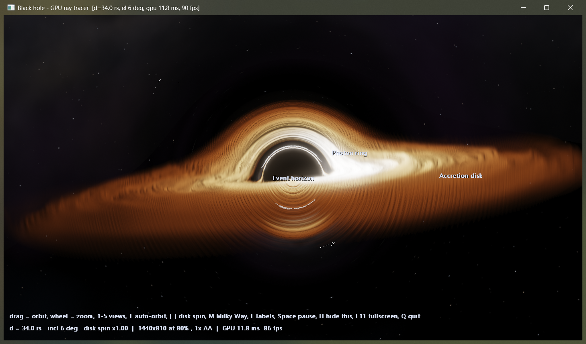
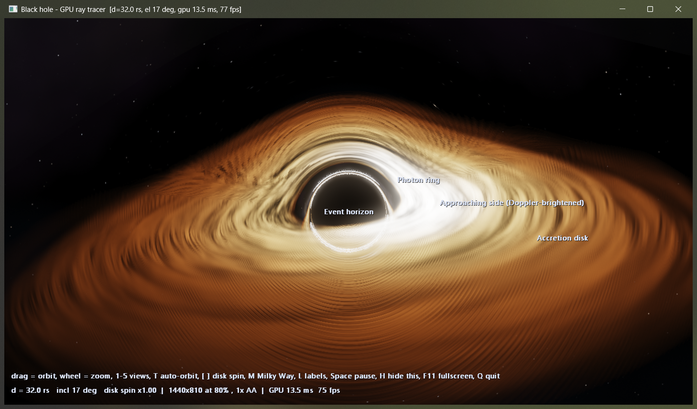
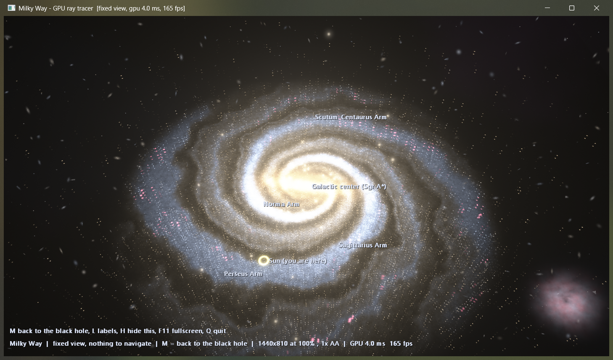

# black-hole

A Schwarzschild black hole ray-traced on the GPU with Direct3D 11 compute shaders, in a native window or in a terminal. Press `m` for a locked, detailed picture of the Milky Way.

<p align="center">
  
</p>
<p align="center">
  
  
</p>

## the black hole

Every pixel's light ray is integrated through the Schwarzschild metric (`u'' = -u + 1.5 u^2`, with `u = 1/r` in Schwarzschild radii), so the shadow, the photon ring, and the disk bent over the top and under the bottom of the hole come out of the physics instead of being drawn.

- the accretion disk is ray-marched along the bent rays: a thin, warped, ragged disk out to 20 Schwarzschild radii with a thin-disk temperature profile, so it runs from white-hot at the inner edge through amber and orange to dusty brown
- the matter orbits at the local Kepler speed, so the side moving toward you is Doppler-boosted and bluer, the other side dimmer and redder, and light from deep in the well is gravitationally redshifted
- the disk texture is noise in the co-rotating frame, so differential rotation winds it into streaks as it turns
- whatever a ray escapes to is looked up in a lensed sky of procedural stars, a Milky Way band and nebulae
- dust lanes that block the light behind them, thin filaments, and a faint hot corona around the horizon
- the rays that skim the photon sphere get extra samples so the photon ring stays clean, and a filmic tone curve rolls the highlights off toward white
- bloom finishes the image

It is a non-rotating (Schwarzschild) hole and an artistic disk model, not a full radiative simulation.

## the Milky Way (`m`)

A fixed picture, so there is nothing to navigate: orbit, zoom, presets and the mouse are all disabled until you press `m` again. It is all procedural:

- logarithmic spiral arms (two major, two minor, plus spurs), a central bar and a bulge
- dust lanes along the arms and the bar, HII regions, young blue and old yellow stars, individually resolved stars
- globular clusters, the two Magellanic Clouds, a halo, a deep field of faint background galaxies
- a ring marking the Sun's place between two arms, and labels for the arms (`l` toggles them)

It is an artistic model of the galaxy, not a survey image.

## build

Needs Windows, the MSVC compiler (`cl`), and a GPU with Direct3D 11 compute (feature level 11_0). `blackhole.hlsl` must sit next to the exe. Compiled shaders are cached as `.cso` files beside it; the first run after a shader change takes about a minute.

```
:: window build: full resolution, no pixel blocks
cl /O2 /W4 /nologo /DWINDOWED /Foblackholewin.obj /Fe:blackholewin.exe blackhole.c /link /SUBSYSTEM:WINDOWS /ENTRY:mainCRTStartup

:: terminal build (Windows Terminal: truecolor, UTF-8, sextant glyphs)
cl /O2 /W4 /nologo blackhole.c
```

Options: `--view K` starts on preset K, `--galaxy` starts in the Milky Way view, `--fps N` caps the terminal frame rate, `--mode half|quad|sext` picks the terminal sub-pixel mode, `--frames N --size CxR` renders N frames to stdout and exits (used for testing).

## keys

| key | |
|---|---|
| drag mouse, arrows, `a` `d` `w` `s` | orbit |
| wheel, `+` `-` | zoom |
| `1`-`5` | views: edge-on, oblique, steep, top-down, close-in; `0` resets to the default, a shallow angle with a slight tilt |
| `t` | auto-orbit on/off |
| `[` `]` | disk spin speed |
| space | pause |
| `l` | labels |
| `m` | Milky Way, locked; press again to return |
| `h`, `F11` | hide the help text, fullscreen (window build) |
| `n` | cycle the sub-pixel mode (terminal build) |
| `q`, Esc | quit |

## how it stays fast

- rays that cannot reach the disk take coarse steps; rays near it take small ones, and every ray leaves the loop the moment it falls in or escapes
- the window build renders at a scale chosen from measured GPU time (timestamp queries) and upscales, so it holds its frame budget on any GPU or window size; the swap chain keeps one frame in flight
- bloom runs at the internal resolution, not the window's
- the terminal build fits the best two colors for every cell on the GPU, reads the result back through a ping-pong buffer, and rewrites only the cells that changed
- compiled shaders are cached

Measured on an RTX 4050 laptop GPU at 1440x810: about 12 ms of GPU time per frame for the black hole at full resolution (the window scales down on its own if a frame would run over 14 ms) and 2-4 ms for the Milky Way.
